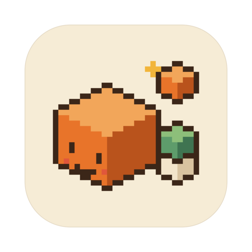

# HD Voxel Builder

A local macOS app that turns a short description into a voxel model with Claude, previews it in 3D, and sends it to MagicaVoxel.

## Features

- Generate original chibi characters, objects and small scenes on a base from a description, with Opus or Sonnet; a result that fails validation is retried once.
- Start from up to three reference images: Claude drafts a description from them, and they can go along with the request.
- Refine a model through conversation: every version is saved with the parts it changed, and any version can be reopened.
- Inspect models in an orbiting 3D viewport with part highlighting, a layer-by-layer build animation, and checks for bounds, colors, names, and floating parts.
- Send `.vox` files to MagicaVoxel's project list, restarting it after confirmation.

## Tech Stack

- Desktop: Tauri 2 and Rust, which runs the logged-in Claude Code (`claude -p`) and handles files and MagicaVoxel.
- UI: Vite, React 19, TypeScript (strict mode), Zustand, and handwritten CSS.
- Model pipeline: deterministic geometry, a Canvas 2D renderer, and a `.vox` writer, all in TypeScript.

## Getting Started

### Prerequisites

- macOS 12+ with Xcode Command Line Tools
- Node.js 22.12+ and pnpm 12.9.1
- Rust
- [Claude Code](https://claude.com/claude-code), installed and logged in; generation uses your own subscription and the app stores no API key
- [MagicaVoxel](https://ephtracy.github.io) in `/Applications`, with the quarantine flag removed so it does not open to a black screen:

  ```sh
  xattr -dr com.apple.quarantine /Applications/MagicaVoxel-*/
  ```

### Installation

```sh
git clone https://github.com/Hongda-OSU/hd-voxel-builder.git
cd hd-voxel-builder
pnpm install
```

## Usage

```sh
pnpm dev    # Run the desktop app
pnpm build  # Build src-tauri/target/release/bundle/macos/HD Voxel Builder.app
```

In the app:

- **New model**: pick a style, describe it, and press Return. Drop or paste up to three images and click 看图写描述 to draft the description from them.
- **Edit**: click a project to view it, then 修改 (or double-click) to open its versions and type changes such as 「车斗再长两格」.
- **Export**: **在 MagicaVoxel 中打开** restarts MagicaVoxel with the model in its Project list; change its folder with ⌘,.
- **Show off**: **▶ 搭建** replays the build; **Window › 录屏尺寸** sets the window to 1280 × 800 for recordings.

Projects and their versions are saved in `~/HDVoxel/projects/<id>/`.

To try prompts without the app, `pnpm gen` saves a spec to `src/prompts/examples/<slug>-<model>.local.json`, which git ignores:

```sh
pnpm gen basketball --style object --model sonnet "一个篮球"
pnpm gen hero --style chibi --model opus --image ref.png "做成图里这个角色"
pnpm gen hero --describe --image ref.png   # Draft a description from images
```
